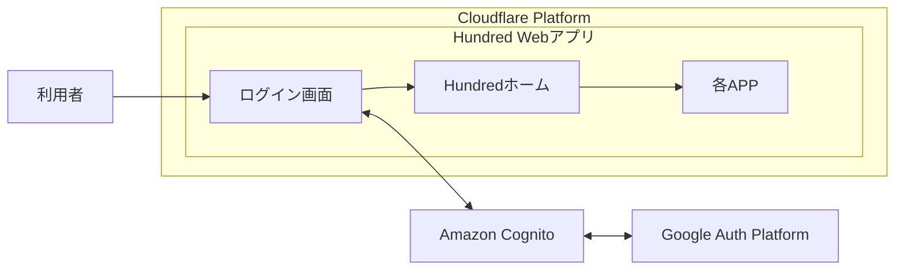
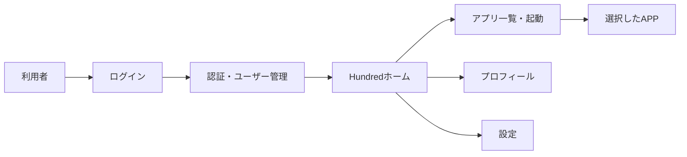

# Hundred システム概要

> AI Desktopが生成したファイルです。直接編集せず、AI Desktopで変更してください。
> AI Desktop上の最終更新：2026/09/30 07:01

### 1. システム概要

#### 1.1 概要

Hundredは、個人開発で作成した複数のAPPを、一つのホーム画面から起動して利用するためのWebプラットフォームです。

#### 1.2 目的・利用者

| 項目 | 内容 |
| --- | --- |
| 目的 | 個人開発を通じてさまざまな技術に触れ、知識を身につける。 |
| 目標 | 100個のAPPを作成する。この目標から「Hundred」と命名した。 |
| 利用者 | 個人利用者。 |
| 主な利用内容 | HundredホームからAPPを選択して起動する。 |

### 2. 要件対応表

### 3. システム構成

#### 3.1 システム構成図

**Hundred システム構成図**

*Hundred WebアプリはCloudflare Platform上で稼働します。認証にはAmazon Cognitoを利用し、GoogleログインではGoogle Auth Platformと連携します。*

#### 3.2 構成要素一覧

| 構成要素 | 区分 | 役割・連携内容 | 管理主体 |
| --- | --- | --- | --- |
| Cloudflare Platform | 外部基盤 | Hundred Webアプリを公開・配信する。 | Cloudflare |
| Hundred Webアプリ | Hundred内部 | ブラウザ上でログイン画面、Hundredホーム、各APPを提供する。 | Hundred |
| ログイン画面 | Hundred内部 | メールアドレス認証、Googleログイン、ゲスト利用の入口を提供する。 | Hundred |
| Hundredホーム | Hundred内部 | 共通メニューとAPP一覧を表示し、選択したAPPを起動する。 | Hundred |
| 各APP | Hundred内部 | Hundredホームから起動され、それぞれの機能を提供する。 | Hundred |
| Amazon Cognito | 外部サービス | メールアドレス認証、ユーザー情報、ログイン状態を管理する。 | AWS |
| Google Auth Platform | 外部サービス | Amazon Cognitoを経由したGoogleアカウント認証を提供する。 | Google |

### 4. 機能構成

#### 4.1 機能構成図

**Hundred 機能構成図**

*利用者はログイン後にHundredホームを利用し、APPの起動、プロフィールの確認、設定の変更を行います。*

#### 4.2 機能一覧

| 機能ID | 機能名 | 機能説明 |
| --- | --- | --- |
| F-001 | ログイン | メールアドレス、Googleアカウント、またはゲストとしてHundredの利用を開始する。 |
| F-002 | 認証・ユーザー管理 | 認証状態とユーザー情報を管理する。 |
| F-003 | アプリ一覧・起動 | APPを一覧表示し、選択したAPPを起動する。 |
| F-004 | プロフィール | アカウント情報の確認と表示名の変更を行う。 |
| F-005 | 設定 | 壁紙、操作音、通知を設定する。 |

### 5. 前提・制約事項

| 区分 | 条件 | プロジェクトへの影響 |
| --- | --- | --- |
| 前提 | 個人で開発・運用する。 | レビュー、開発、障害対応を一人で継続できる構成にする。 |
| 制約 | 運用費を最低限に抑える。 | 採用サービス、保存容量、処理量、機能の優先順位に影響する。 |
| 制約 | Cloudflare PlatformとAmazon Cognitoを利用する。 | 配信方式と認証方式は既存基盤を前提に設計する。 |
| 未決事項 | PWAを採用する方針だが、現在の対応状況は未確認。 | 対応する場合は実装、端末試験、リリース方法に影響する。 |

### 6. 変更履歴

| 版 | 変更内容 | 更新者 | 更新日 |
| --- | --- | --- | --- |
| 0.2 | 文書概要を削除し、目的と利用者をシステム概要へ統合 | yama | 2026/09/30 |
| 0.1 | 現行実装をもとに初版を作成 | yama | 2026/09/29 |
