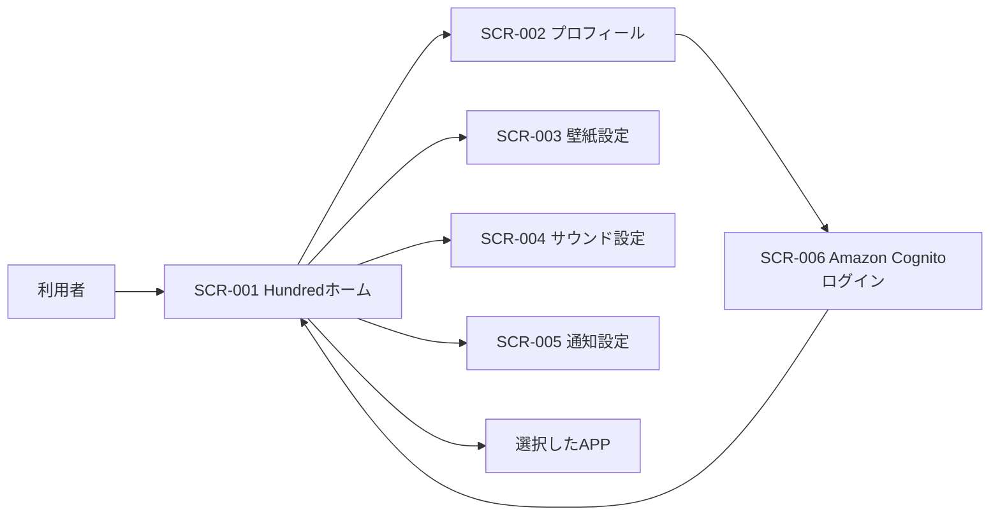

# Hundred 画面設計書

> AI Desktopが生成したファイルです。直接編集せず、AI Desktopで変更してください。
> AI Desktop上の最終更新：2026/09/30 06:48

### 1. 画面一覧

| 画面ID | 画面名 | 画面種別 | 概要 |
| --- | --- | --- | --- |
| SCR-001 | Hundredホーム | 画面 | カテゴリとAPPを表示し、選択したAPPや設定を開く。 |
| SCR-002 | プロフィール | ダイアログ | ログイン状態とプロフィールを表示し、認証や表示名の変更を行う。 |
| SCR-003 | 壁紙設定 | ダイアログ | Hundredホームで使用する壁紙を選択する。 |
| SCR-004 | サウンド設定 | ダイアログ | 効果音の音量とカーソル音を設定する。 |
| SCR-005 | 通知設定 | ダイアログ | 通知全体とAPPごとの通知可否を設定する。 |
| SCR-006 | Amazon Cognitoログイン | 外部画面 | メールアドレスまたはGoogleアカウントで認証する。 |

### 2. 画面遷移図

**Hundred 画面遷移図**

*Hundredホームを起点に、プロフィールと各設定を開きます。認証はAmazon Cognitoのログイン画面へ遷移し、完了後にHundredホームへ戻ります。*

### 3. 画面共通仕様

| 分類 | 適用先 | 共通仕様 |
| --- | --- | --- |
| レイアウト | Hundredホーム | カテゴリを横方向、選択中カテゴリの内容を縦方向に配置する。 |
| 操作 | Hundredホーム | クリック・タップで選択する。PCでは方向キーでもカテゴリとAPPを移動できる。 |
| ダイアログ | 共通 | 背景の上にモーダル表示し、閉じるボタンまたはEscapeキーで閉じる。 |
| レスポンシブ | 共通 | PCとスマートフォンの画面幅に応じて、配置と表示サイズを調整する。 |
| 認証 | プロフィール | ゲスト利用を許可し、ログイン操作時はAmazon Cognitoへ遷移する。 |
| エラー表示 | 共通 | 操作に失敗した場合は、対象画面内にエラー内容を表示する。 |

### 4. SCR-001 Hundredホーム

#### PC

*Hundredホーム（PC）*

#### スマホ

*Hundredホーム（スマホ）*

#### 画面項目定義

| 項目ID | 項目名 | 種別 | 入出力 | 必須 | 表示・入力内容 | 備考 |
| --- | --- | --- | --- | --- | --- | --- |
|  |  |  |  |  |  |  |
|  |  |  |  |  |  |  |
|  |  |  |  |  |  |  |

#### 画面イベント定義

| イベントID | イベント名 | 発生条件 | 処理内容 | 遷移先 | エラー時の動作 |
| --- | --- | --- | --- | --- | --- |
|  |  |  |  |  |  |
|  |  |  |  |  |  |
|  |  |  |  |  |  |

### 5. SCR-002 プロフィール

#### PC

*プロフィール（PC）*

#### スマホ

*プロフィール（スマホ）*

#### 画面項目定義

| 項目ID | 項目名 | 種別 | 入出力 | 必須 | 表示・入力内容 | 備考 |
| --- | --- | --- | --- | --- | --- | --- |
|  |  |  |  |  |  |  |
|  |  |  |  |  |  |  |
|  |  |  |  |  |  |  |

#### 画面イベント定義

| イベントID | イベント名 | 発生条件 | 処理内容 | 遷移先 | エラー時の動作 |
| --- | --- | --- | --- | --- | --- |
|  |  |  |  |  |  |
|  |  |  |  |  |  |
|  |  |  |  |  |  |

### 6. SCR-003 壁紙設定

#### PC

*壁紙設定（PC）*

#### スマホ

*壁紙設定（スマホ）*

#### 画面項目定義

| 項目ID | 項目名 | 種別 | 入出力 | 必須 | 表示・入力内容 | 備考 |
| --- | --- | --- | --- | --- | --- | --- |
|  |  |  |  |  |  |  |
|  |  |  |  |  |  |  |
|  |  |  |  |  |  |  |

#### 画面イベント定義

| イベントID | イベント名 | 発生条件 | 処理内容 | 遷移先 | エラー時の動作 |
| --- | --- | --- | --- | --- | --- |
|  |  |  |  |  |  |
|  |  |  |  |  |  |
|  |  |  |  |  |  |

### 7. SCR-004 サウンド設定

#### PC

*サウンド設定（PC）*

#### スマホ

*サウンド設定（スマホ）*

#### 画面項目定義

| 項目ID | 項目名 | 種別 | 入出力 | 必須 | 表示・入力内容 | 備考 |
| --- | --- | --- | --- | --- | --- | --- |
|  |  |  |  |  |  |  |
|  |  |  |  |  |  |  |
|  |  |  |  |  |  |  |

#### 画面イベント定義

| イベントID | イベント名 | 発生条件 | 処理内容 | 遷移先 | エラー時の動作 |
| --- | --- | --- | --- | --- | --- |
|  |  |  |  |  |  |
|  |  |  |  |  |  |
|  |  |  |  |  |  |

### 8. SCR-005 通知設定

#### PC

*通知設定（PC）*

#### スマホ

*通知設定（スマホ）*

#### 画面項目定義

| 項目ID | 項目名 | 種別 | 入出力 | 必須 | 表示・入力内容 | 備考 |
| --- | --- | --- | --- | --- | --- | --- |
|  |  |  |  |  |  |  |
|  |  |  |  |  |  |  |
|  |  |  |  |  |  |  |

#### 画面イベント定義

| イベントID | イベント名 | 発生条件 | 処理内容 | 遷移先 | エラー時の動作 |
| --- | --- | --- | --- | --- | --- |
|  |  |  |  |  |  |
|  |  |  |  |  |  |
|  |  |  |  |  |  |

### 9. SCR-006 Amazon Cognitoログイン

#### PC

*Amazon Cognitoログイン（PC）*

#### スマホ

*Amazon Cognitoログイン（スマホ）*

#### 画面項目定義

| 項目ID | 項目名 | 種別 | 入出力 | 必須 | 表示・入力内容 | 備考 |
| --- | --- | --- | --- | --- | --- | --- |
|  |  |  |  |  |  |  |
|  |  |  |  |  |  |  |
|  |  |  |  |  |  |  |

#### 画面イベント定義

| イベントID | イベント名 | 発生条件 | 処理内容 | 遷移先 | エラー時の動作 |
| --- | --- | --- | --- | --- | --- |
|  |  |  |  |  |  |
|  |  |  |  |  |  |
|  |  |  |  |  |  |

### 10. 変更履歴

| 版 | 変更内容 | 更新者 | 更新日 |
| --- | --- | --- | --- |
| 0.1 | 画面設計書の初版を作成 | yama | 2026/09/30 |
