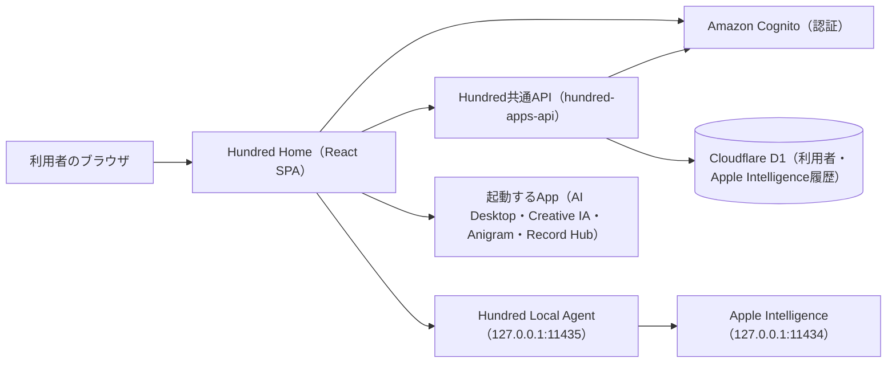

# 概要と構成

> AI Desktopが生成したファイルです。直接編集せず、AI Desktopで変更してください。

Hundredは、AI Desktop・Creative IA・Anigram・Record HubなどのAppを1つの入口からまとめて使うためのプラットフォームです。

Hundred本体は、サインイン（Amazon Cognito、ゲスト利用あり）、XMB型のHundred Home、Appの一覧と起動、プロフィール、壁紙・効果音・通知などの共通設定、全App共通のApple Intelligenceを受け持ちます。各Appの画面・データ・業務ルールは各Appが受け持ち、Hundredは直接編集しません。

## システム構成図



## ファイル構成

```text
hundred/
├── frontend/
│   └── src/
│       ├── main.tsx                         # エントリーポイント、Cognito認証の初期化
│       ├── App.tsx                          # ルーティング（/ がHundred Home、各Appのパス）
│       ├── pages/Hundred/HundredHomePage.tsx
│       ├── components/Hundred/
│       │   ├── Auth/                        # サインイン画面、Cognito設定、ゲストセッション
│       │   ├── Home/HundredHome.tsx         # XMB型Home、カテゴリとAppの選択、App起動
│       │   ├── Layout/                      # App画面の共通レイアウト
│       │   ├── Profile/                     # プロフィール
│       │   ├── Notification/                # 通知設定
│       │   ├── Wallpaper/                   # 動く壁紙と壁紙選択
│       │   ├── Sound/                       # カーソル音と効果音
│       │   ├── Theme/                       # 配色
│       │   └── AppleIntelligence/           # 全App共通のApple Intelligence
│       ├── services/AppleIntelligence/      # Local Agentと会話履歴APIの呼び出し
│       └── styles/Hundred/                  # Hundred本体のCSS
├── workers/apps-api/                       # 共用API（Hundredは認証検証、Apple Intelligence履歴を利用）
├── local-agent/                            # Apple Intelligenceとの中継（ローカル専用）
└── ドキュメント/                            # 詳細設計、UI設計書、コーディング規約、UI表記ルール
```
